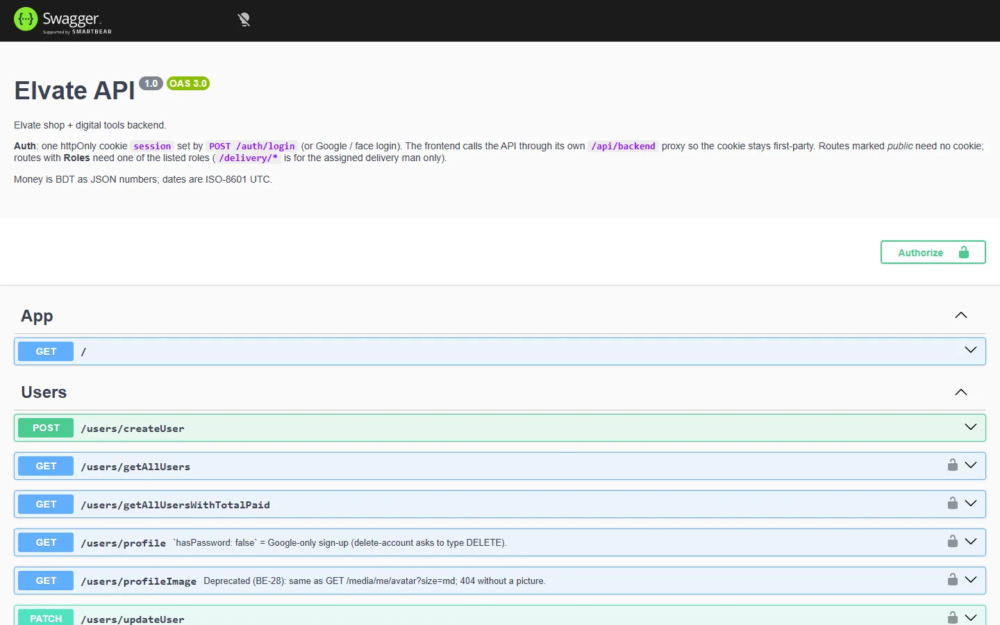
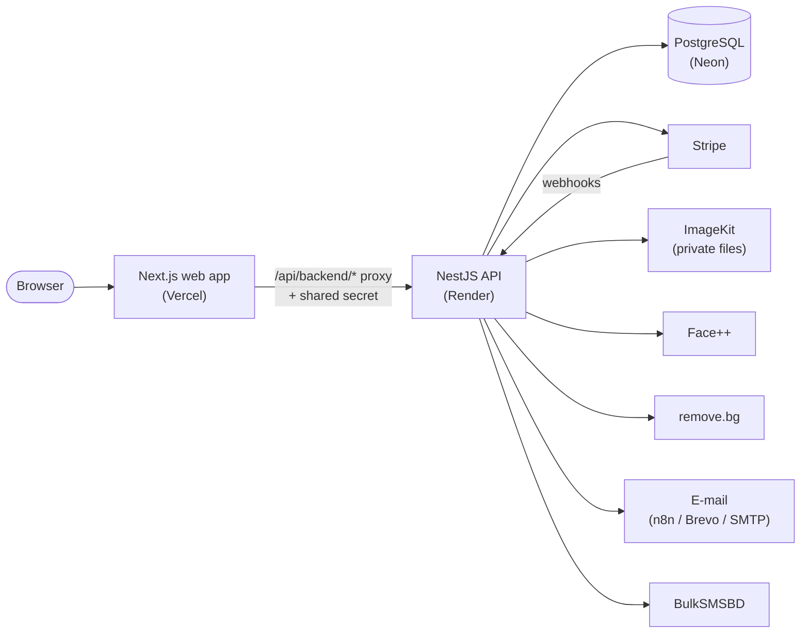
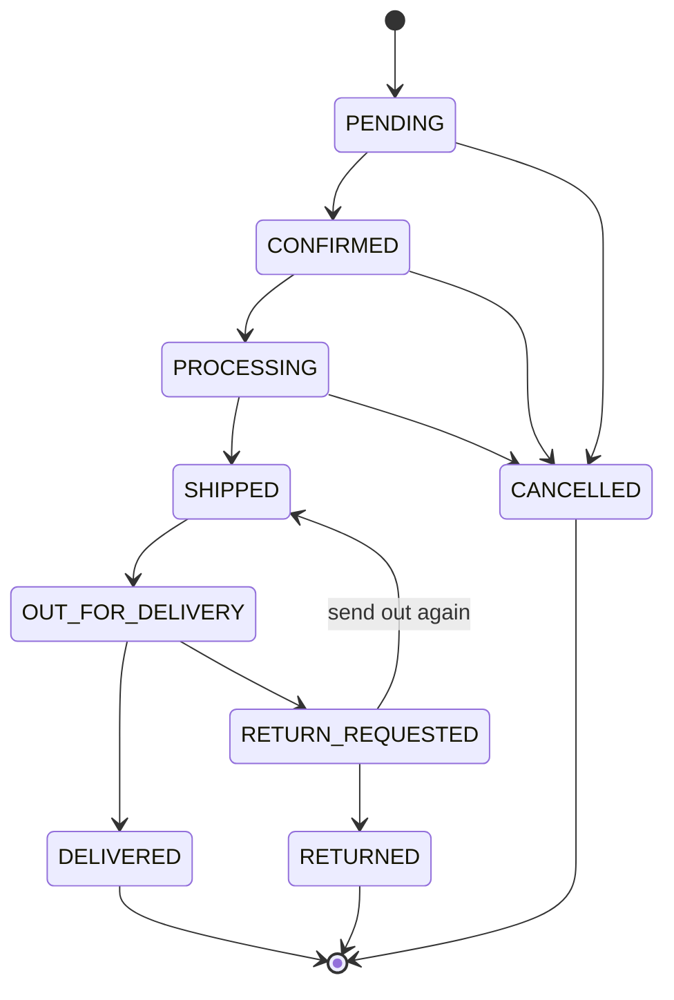

<p align="center">
  
</p>

<h1 align="center">Elvate · REST API</h1>

<p align="center">
  <b>The backend for Elvate: a fashion shop and subscription-based digital tools.</b><br>
  Accounts and security, catalogue, cart, checkout, orders and delivery, offers, reviews, subscriptions and admin analytics.
</p>

<p align="center">
  
  
  
  
  
  
  
</p>

<p align="center">
  <a href="https://elvate.vercel.app"><b>Live site</b></a> ·
  <a href="https://elvate-rest-api.onrender.com/docs"><b>API docs (Swagger)</b></a> ·
  <a href="https://github.com/azminur2856/elvate-frontend"><b>Frontend repository</b></a> ·
  <a href="https://github.com/azminur2856/elvate-frontend/blob/main/docs/screenshots/README.md"><b>Screenshots</b></a>
</p>

---

## Highlights

- 🛒 **Full shop backend**: category tree, products with variants and stock, cart, coupons, flash sales, reviews, cash on delivery and Stripe
- 🚚 **Order and delivery workflow** with a status timeline, delivery-man assignment, return requests and logged admin corrections
- 🧰 **Digital tools** for subscribers: PDF / image to text, image resize, image editing and background removal
- 🔐 **Security first**: encrypted session cookie, per-device sessions, login lockout, rate limits, face login with a liveness check
- 🎛️ **Admin feature switches**: turn SMS codes or face login on and off without a deploy
- 📘 **117 documented routes** in Swagger, plus `openapi.json` in the repository; 60 unit test suites and 2 end-to-end suites

<p align="center">
  
</p>

---

## Table of contents

- [Features](#features)
- [Security](#security)
- [Tech stack](#tech-stack)
- [Architecture](#architecture)
- [Order lifecycle](#order-lifecycle)
- [Roles and permissions](#roles-and-permissions)
- [API overview](#api-overview)
- [Getting started](#getting-started)
- [Environment variables](#environment-variables)
- [Scripts](#scripts)
- [Testing](#testing)
- [Deployment](#deployment)
- [Project structure](#project-structure)
- [Known limitations](#known-limitations)
- [Author](#author) · [License](#license)

---

## Features

### Accounts and sign-in
- Sign-up with e-mail verification; login with e-mail and password, **Google sign-in**, or **face login**
- **Face login**: setup checks a fresh camera photo against the user's profile picture (after re-entering the password), then keeps it as a
  **private reference photo**. Each login starts with a short **liveness challenge** (turn your head or blink) that is valid once, for 2 minutes
- Session in one **httpOnly, encrypted cookie** (JWE) with short-lived access and refresh tokens and refresh-token rotation
- **Per-device sessions**: list signed-in devices, sign out one device or all of them
- Forgot / reset password by e-mail link or SMS code, phone verification by SMS, change password, delete account

### Shop and checkout
- **Catalogue**: Men / Women / Children category tree, products with sizes, colours, stock per variant and photo galleries
- Search, filters (category, price, size, colour, brand, on sale, in stock), sorting and related products
- **Cart** for signed-in users, plus pricing for a guest cart that is merged after login
- **Address book** with a default address
- **Checkout**: server-side price quote, coupon codes, delivery fee (inside / outside Dhaka, free above a threshold);
  pay by **cash on delivery** or **card (Stripe Checkout)**
- Stock is reserved inside a database transaction; unpaid or unconfirmed orders are cancelled automatically and their stock returns

### Orders and delivery
- Order history and detail with a **status timeline** (who changed what, and when), cancellation with a Stripe refund when already paid
- Staff and admins confirm, prepare and ship orders, assign a delivery man and keep private notes
- **Only the assigned delivery man** marks an order *out for delivery*, *delivered* (cash collected) or *return requested*
- Staff confirm a return (refund and restock) or send the parcel out again; an admin can record a **logged correction** when a delivery man
  cannot update an order himself
- A deliveries summary: waiting, assigned, out for delivery, delivered today, return requests and cash collected today
- E-mail notifications for order updates

### Offers and reviews
- Percentage or fixed **coupons** with limits, dates and per-user caps; time-limited **flash sales**
- **Verified-purchase reviews** with moderation and average ratings
- A wishlist API (ready for a future page in the web app)

### Subscriptions and digital tools
- Monthly, 6-month and yearly plans through **Stripe Checkout**; renewals, refunds and disputes recorded from Stripe webhooks
- Subscriber-only tools: **PDF to text**, **image to text (OCR)**, **image resize**, **image editing**
  (crop, rotate, brightness, contrast, blur, grayscale, flip) and **background removal**

### Administration
- Statistics for users, orders, revenue, subscriptions, payments and activity
- User management (roles, activation, deletion), products, categories, coupons, flash sales and review moderation
- Full **activity log** of user and admin actions with filters and CSV export
- **Feature switches** stored in the database: SMS codes (off by default) and face login (on by default)

### Photos
- Profile photos are **private files**, served through `/media/*` with access rules (the owner, admins and staff, and a delivery man for
  his own customers); shop photos are sent as `/img/*` paths that the web app serves. No image-host address appears in any response

---

## Security

| Area | What is in place |
|---|---|
| Sessions | Encrypted httpOnly cookie; refresh tokens hashed with argon2 and rotated; replaying an old refresh token ends that session; blocked users lose access immediately |
| Sign-in | Same answer for an unknown e-mail and a wrong password; **5 failed logins in 15 minutes lock that sign-in for 15 minutes**; passwords hashed with bcrypt, at least 8 characters with letters and numbers |
| Google | OAuth `state` check; only e-mails verified by Google are accepted |
| CSRF | Sign-in routes accept JSON only; face login checks the request origin |
| Face login | Private reference photo; short-lived signed links for the face service; one-time liveness challenge; password re-entry to set it up; e-mail alert when it is set up; admin switch |
| SMS codes | Random codes, only the latest one works, 5 wrong tries void it; the reset needs the e-mail and the code |
| Rate limits | On sign-in, sign-up, SMS, orders, quotes and the digital tools, keyed by the real client IP (sent by the web app with a shared secret, so it cannot be faked) |
| Orders and payments | Row locks for stock and refunds; at most 3 unpaid pending orders per user; auto-cancel after 48 h (cash on delivery) or 2 h (card); refunds only after staff confirm a return |
| Uploads | 10 MB and one file per request; real image type checked from the content; at most 25 megapixels; PDFs read up to 20 pages; a damaged PDF gets a clear 400 |
| Input and output | Global validation with whitelisted fields (no mass assignment; only admins change roles); names escaped in e-mails; CSV export protected from formula injection |
| Configuration | helmet security headers, production CORS without `localhost`, Stripe webhook signature check, no reset or verification tokens in any response, seed data only with a chosen password, dependencies audited |

---

## Tech stack

| Area | Technology |
|---|---|
| Framework | [NestJS 11](https://nestjs.com) (Express), TypeScript |
| Database | PostgreSQL ([Neon](https://neon.tech)) with TypeORM |
| Auth | Passport (local, JWT, Google OAuth 2.0), `jose` (encrypted session cookie), bcrypt, argon2 |
| Payments | Stripe (Checkout, subscriptions, webhooks, refunds) |
| Files and images | ImageKit (private storage and CDN), sharp (image processing), Multer (uploads) |
| Text extraction | pdf-parse, tesseract.js (one shared worker with a queue) |
| Face verification | Face++ API |
| Background removal | remove.bg API |
| E-mail and SMS | n8n webhook, Brevo or SMTP (Nodemailer); BulkSMSBD |
| API docs | @nestjs/swagger (Swagger UI at `/docs`, `openapi.json`) |
| Security | class-validator, @nestjs/throttler, helmet |
| Testing | Jest, Supertest |

---

## Architecture



- The web app calls the API through its own `/api/backend/*` route (a Next.js rewrite), so the session cookie is **first-party** to the
  website and the web app can read the user's role for page protection.
- The session cookie is `httpOnly`, `sameSite=lax` and `secure` in production, encrypted with `COOKIES_SECRET`, which the web app shares.
- The server runs in UTC (`src/set-timezone.ts`), so timestamps are the same on every machine.

---

## Order lifecycle



| Move | Who |
|---|---|
| Confirm, prepare, ship, cancel | Staff and admins (a paid card order confirms itself) |
| Out for delivery, delivered, return requested | **Only the assigned delivery man** |
| Confirm a return (refund and restock) or send it out again | Staff and admins |
| Correction while out for delivery (delivered or return requested, with a reason and a note) | Admins only; it is logged and the delivery man is told |
| Cancel | The customer, while the order is pending or confirmed |

`CANCELLED` and `RETURNED` put the stock back and release the coupon. A cash-on-delivery order becomes paid when it is delivered.

---

## Roles and permissions

| Role | Can do |
|---|---|
| `BUYER` | Shop, cart, checkout, own orders and reviews, subscriptions, digital tools, own profile and settings |
| `STAFF` | Everything a buyer can, plus orders, deliveries, products, stock, categories and review moderation |
| `DELIVERY_MAN` | Only the orders assigned to him: delivery progress and cash collection |
| `ADMIN` | Everything staff can, plus users and roles, coupons and flash sales, payments, subscriptions, statistics, activity logs, feature switches and delivery corrections. Admins manage deliveries but do not perform them |

Only an admin can change a user's role.

---

## API overview

All routes are JSON and use the `session` cookie for authentication. **Interactive docs: [`/docs`](https://elvate-rest-api.onrender.com/docs)**
(switched on with `SWAGGER_ENABLED`). The full specification is also committed as [`openapi.json`](openapi.json).

| Module | Base path | Highlights |
|---|---|---|
| Auth | `/auth` | `login`, `refresh`, `logout`, `logout-all`, `sessions`, `google/login`, `face-login/challenge`, `login-with-face`, `forgotPassword`, `resetPassword`, `verifyPhone`, `changePassword` |
| Users | `/users` | `createUser`, `profile`, `updateUser`, `updateProfileImage`, `face-reference`, `me` (delete); admin user management and stats |
| Media | `/media` | private profile photos: `avatar/:key`, `me/avatar`, `users/:id/avatar` |
| Settings | `/settings`, `/admin/settings` | public feature flags; admin switches |
| Categories | `/categories` | category tree; admin create, update, delete |
| Products | `/products`, `/admin/products` | list with filters and sorting, filter options, detail, related; admin CRUD, photos, variants |
| Cart | `/cart` | view, add, update, remove, clear, guest `preview`, `merge` after login |
| Addresses | `/addresses` | address book with a default address |
| Orders | `/orders`, `/admin/orders` | `quote`, place, my orders, detail, cancel, pay; admin list, status, assign, notes, correction, stats |
| Deliveries | `/delivery`, `/admin/deliveries` | delivery man's orders, status updates, stats; admin summary |
| Offers | `/offers`, `/admin/coupons`, `/admin/flash-sales` | public offers; coupon and flash-sale management |
| Reviews | `/products/:slug/reviews`, `/reviews`, `/admin/reviews` | product reviews, eligibility, my reviews, featured, moderation |
| Wishlist | `/wishlist` | saved products |
| Subscriptions | `/subscriptions` | `checkout`, `webhook`, `status`, `subscriptionDetails`, `cancel`, `paymentsHistory`; admin stats and history |
| Digital tools | `/ocr` | `upload/pdf`, `upload/image`, `image/resize`, `image/edit`, `image/remove-bg` |
| Activity logs | `/activity-logs` | own log, admin list, filters, CSV export, stats |
| Health | `/healthz` | uptime check |

---

## Getting started

### Prerequisites
- **Node.js 22** and npm
- A **PostgreSQL** database (a free [Neon](https://neon.tech) project works well)
- Accounts for the services you want to use (test keys are fine): Stripe, ImageKit, Google OAuth, Face++, remove.bg, an e-mail transport
- Optional: the [Stripe CLI](https://stripe.com/docs/stripe-cli) to receive webhooks locally

### Install and run

```bash
git clone https://github.com/azminur2856/Elvate-Rest-Api.git
cd Elvate-Rest-Api
npm install
cp .env.example .env      # then fill in the values (see below)
npm run start:dev         # http://localhost:8000, API docs at http://localhost:8000/docs
```

> [!WARNING]
> **Use a separate development database.** TypeORM runs with `synchronize: true`, so starting the server changes the database schema to
> match the code. Never point a local server at the production database. With Neon, create a **branch** of production and use its
> connection string.

### Demo data

```bash
npm run seed -- --yes               # categories, products with pictures, coupons, a flash sale, demo staff and delivery man
npm run seed -- --yes --no-images   # the same, without uploading pictures
```

Needs `SEED_DEMO_PASSWORD` (the password of the demo accounts). Safe to run more than once: it only adds what is missing.

### Payments locally

```bash
stripe login
stripe listen --forward-to localhost:8000/subscriptions/webhook
```

Put the `whsec_…` secret that `stripe listen` prints into `STRIPE_WEBHOOK_SECRET`. In test mode, pay with the card
`4242 4242 4242 4242`, any future date and any CVC.

---

## Environment variables

<details>
<summary><b>Show the variables</b> (copy <code>.env.example</code> to <code>.env</code>)</summary>

| Variable(s) | Purpose |
|---|---|
| `NODE_ENV` | `development` locally, `production` on the server (secure cookie, strict CORS) |
| `DATABASE_URL` | PostgreSQL connection string |
| `JWT_SECRET`, `JWT_EXPIRES_IN`, `REFRESH_JWT_SECRET`, `REFRESH_JWT_EXPIRES_IN` | Access / refresh token signing and lifetime |
| `COOKIES_SECRET` | Base64 32-byte key that encrypts the session cookie. **Must match the web app** |
| `PROXY_SHARED_SECRET` | Shared with the web app; lets the API trust the client IP it forwards. **Must match the web app** |
| `FRONTEND_URL` | Web app address, used for CORS, e-mail links, Google sign-in and Stripe redirects |
| `GOOGLE_CLIENT_ID`, `GOOGLE_SECRET`, `GOOGLE_CALLBACK_URL` | Google sign-in |
| `MAIL_WEBHOOK_URL`, `MAIL_WEBHOOK_SECRET`, `BREVO_API_KEY`, `EMAIL_HOST`, `EMAIL_PORT`, `EMAIL_SENDER`, `EMAIL_PASSWORD` | E-mail (the first one configured wins: n8n webhook → Brevo → SMTP) |
| `SMS_API_URL`, `SMS_API_KEY`, `SMS_SENDER_ID` | SMS codes |
| `FACEPP_API_KEY`, `FACEPP_API_SECRET` | Face login |
| `IMAGEKIT_PUBLIC_KEY`, `IMAGEKIT_PRIVATE_KEY`, `IMAGEKIT_URL_ENDPOINT` | Photo storage |
| `STRIPE_SECRET_KEY`, `STRIPE_WEBHOOK_SECRET`, `PRICE_1M`, `PRICE_6M`, `PRICE_12M` | Payments and subscription price IDs |
| `SHIPPING_FEE_INSIDE_DHAKA`, `SHIPPING_FEE_OUTSIDE_DHAKA`, `FREE_SHIPPING_THRESHOLD` | Delivery fees in BDT |
| `REMOVE_BG_API_KEY`, `REMOVE_BG_SIZE` | Background removal (the tool says it is unavailable when the key is empty) |
| `SWAGGER_ENABLED` | `true` / `false`; Swagger is on in development and off in production unless this is `true` |
| `SEED_DEMO_PASSWORD` | Password for the demo accounts created by `npm run seed` |

Generate secrets with `openssl rand -base64 32`. Never commit `.env`.

</details>

---

## Scripts

| Command | What it does |
|---|---|
| `npm run start:dev` | Start in watch mode (port 8000) |
| `npm run build` | Compile to `dist/` (not while `start:dev` is running, because it replaces `dist/`) |
| `npm run start:prod` | Run the compiled app |
| `npm run seed` | Load demo data (see above) |
| `npm run openapi` | Write `openapi.json` without starting the server |
| `npm run migrate:avatars` | One-time move of old public profile photos to private files (`--dry-run` first) |
| `npm run lint` / `npm run format` | ESLint (with auto-fix) / Prettier |
| `npm test` / `npm run test:e2e` / `npm run test:cov` | Unit tests / end-to-end tests / coverage |

---

## Testing

```bash
npx jest --maxWorkers=2     # 60 unit test suites (limit workers on machines with little RAM)
npm run test:e2e            # 2 end-to-end suites: cart → quote → order → fulfilment → review
```

---

## Deployment

The API runs on **Render** (web service), with the database on **Neon**.

| Setting | Value |
|---|---|
| Build command | `npm ci --include=dev && npm run build` |
| Start command | `npm run start:prod` |
| Environment | every variable from `.env.example`, with `NODE_ENV=production`, the production `FRONTEND_URL` and `SWAGGER_ENABLED=true` for public docs |
| Google callback | `https://<web-app-domain>/api/backend/auth/google/callback` (through the web app's proxy) |
| Stripe webhook | `https://<api-domain>/subscriptions/webhook` with `checkout.session.completed`, `checkout.session.expired`, `invoice.paid`, `customer.subscription.deleted`, `charge.refunded`, `charge.dispute.created` |
| Keep-alive | Render's free tier sleeps after 15 minutes; an external job calls `/healthz` every 10 minutes |

---

## Project structure

<details>
<summary><b>Show the folders</b></summary>

```
src/
├── account/         account deletion
├── activity-logs/   activity log, filters, CSV export, stats
├── addresses/       address book
├── auth/            login strategies, guards, session cookie, sessions, rate limits, login attempts, mail and SMS
├── cart/            server cart and guest-cart pricing
├── categories/      category tree
├── common/          shared helpers (passwords, image checks, …)
├── config/          database configuration
├── delivery/        delivery man routes
├── face/            face login reference photos
├── health/          /healthz
├── media/           private profile photos
├── ocr/             digital tools (PDF / image text, resize, edit, background removal)
├── offers/          coupons and flash sales
├── orders/          checkout, orders, fulfilment, deliveries summary
├── pricing/         shared price calculation (flash sale > sale price > price)
├── products/        catalogue, variants, photos, admin
├── reviews/         product reviews and moderation
├── scripts/         one-time maintenance scripts
├── seed/            demo data
├── settings/        admin feature switches
├── subscription/    Stripe subscriptions, payments, webhooks
├── users/           users, roles, profile
├── wishlist/        saved products
├── main.ts          app bootstrap (helmet, CORS, validation, Swagger)
├── swagger.ts       API docs setup
├── openapi.ts       writes openapi.json
└── set-timezone.ts  forces UTC before anything else loads
```

</details>

---

## Known limitations

- Render's free tier: the first request after a quiet period can take about 50 seconds while the server wakes up
- SMS codes are off by default (they need SMS credits); e-mail works for every flow
- Face login depends on the Face++ service and the user's camera and light
- The schema is managed with TypeORM `synchronize`; migrations are planned

---

## Author

**Azminur Rahman** · [@azminur2856](https://github.com/azminur2856)

## License

[MIT](LICENSE)
